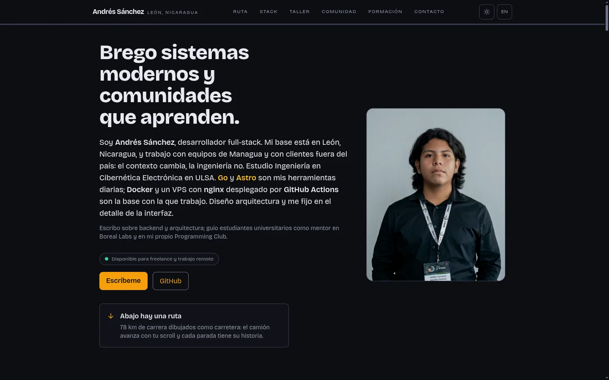
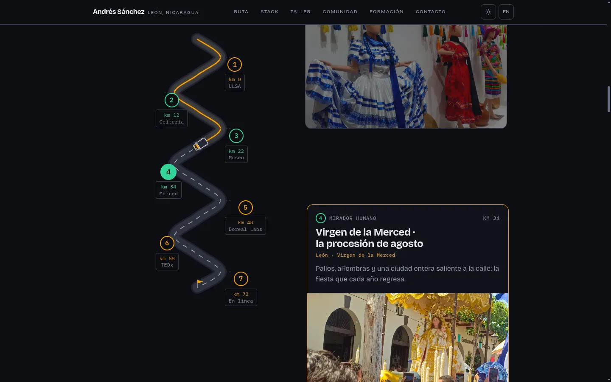
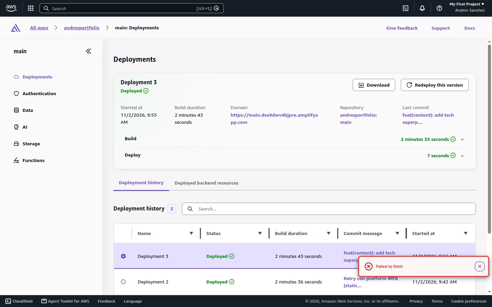

**Live:** https://main.dxe9dwv4bjpro.amplifyapp.com · **Repo:** https://github.com/D-Kale/portfolio

I'm Andrés Sánchez, a full-stack developer from León, Nicaragua, studying Cybernetic Electronic Engineering at ULSA.

## The creative feature: La Ruta

Most portfolios are a list of projects. Mine is a road: my career as a **78 km highway** from León to the online work. Scroll and a truck drives the asphalt — the road behind it turns amber, each milestone lights up, and the stop you're closest to opens with the real evidence behind it.

- One SVG plate draws the shoulder, the asphalt and a separate "traveled" stroke that fills as you scroll.
- A ~1.6 KB vanilla script places the truck with `path.getPointAtLength()` and banks it through every curve. No framework, no animation library.
- Seven real stops: four technical (ULSA, Boreal Labs, TEDx, Online) and three human lookouts (La Gritería, Museo Ortiz Gurdian, Virgen de la Merced) — the León culture feeding the work. Each links to real photos, logos and real repos. On mobile the plate sticks and the cards travel under it; tapping a milestone scrolls the card into place and moves focus to it.

**The visible hint:** the hero ends with an explicit "Abajo hay una ruta" block and a strip of asphalt. A feature nobody finds is a feature that doesn't exist.

## Three core sections

- **About Me** → the hero.
- **Skills / Tech Superpowers** → "Superpoderes técnicos": the real stack (Go, Python, TypeScript, PostgreSQL, Redis, Astro, React, Flutter, Docker, nginx, AWS, GitHub Actions) in four groups.
- **Projects / Achievements** → "El taller": VoxLab (Hackathon Nicaragua), Waresis (multi-tenant ERP), go-storage (pkg.go.dev), ManualGestor, TEDx.

Spanish at `/`, English at `/en/`, persisted light/dark toggle, sticky header, mobile menu that closes on Escape.

## AWS setup

- **AWS Amplify Hosting** serves the site in **us-east-2** (this project's Region), with HTTPS and CDN.
- **Amplify continuous delivery**: `D-Kale/portfolio` → `main` → build → deploy → verify on every push. The screenshot is that pipeline; the last commit shown added the Skills section.
- **Custom build spec** (`amplify.yml`): Node 22 + pnpm 11, `pnpm install --frozen-lockfile`, `pnpm build`, artifacts in `dist`.
- **Environment variables**: `SITE_URL` on the branch, so Astro's `canonical` points at the deployed domain.
- **AWS CLI v2**: `aws login` + `aws amplify` created and connected the app from the terminal. **No access keys in the repo.**

## What I learned

1. **A static site is still a real AWS project** if you use the service for what it is good at: CDN + TLS + CI/CD in one, no VPC, no RDS, nothing that breaks at 3am.
2. **`platform WEB_COMPUTE` vs `WEB` is not a detail.** My first build compiled perfectly and the deploy failed with `Failed to find the deploy-manifest.json file`: the build was fine, the hosting model was wrong.
3. **`getBoundingClientRect()` lies about `sticky` elements** — it measures in-flow position, so mobile pins landed 170 px off.
4. **Weight is a decision**: 51 valid images weren't linked by the site, so I quarantined them outside the deploy — 7.9 MB → 1.9 MB of public assets.

## Challenges

1. `aws login` looked hung; it opens a browser and prints only after the OAuth flow.
2. The mobile pin bug above: invisible on desktop and in unit tests.
3. Contrast passed on paper — 3.1:1 in dark mode. I resolved every colour pair through a canvas and checked WCAG AA.

The GitHub connection still uses OAuth while AWS suggests the GitHub App; it rebuilds on every push, so I left the migration for after the deadline.
